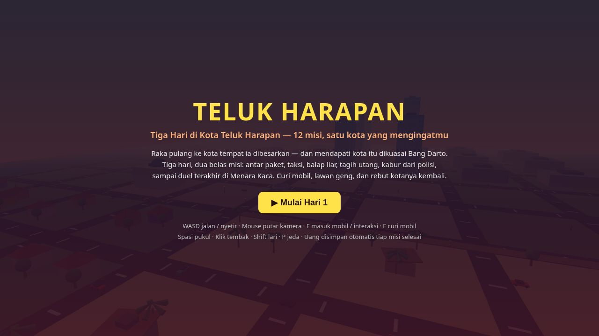
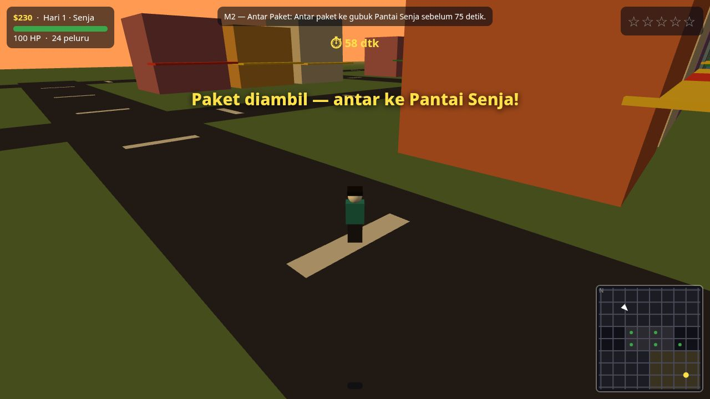
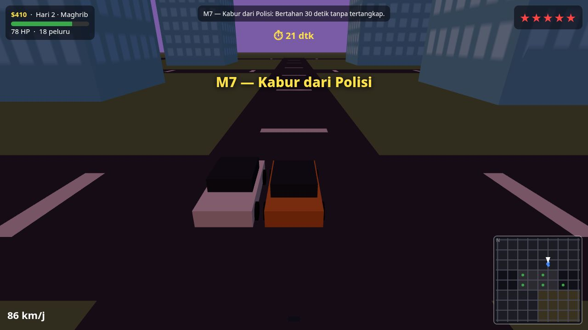
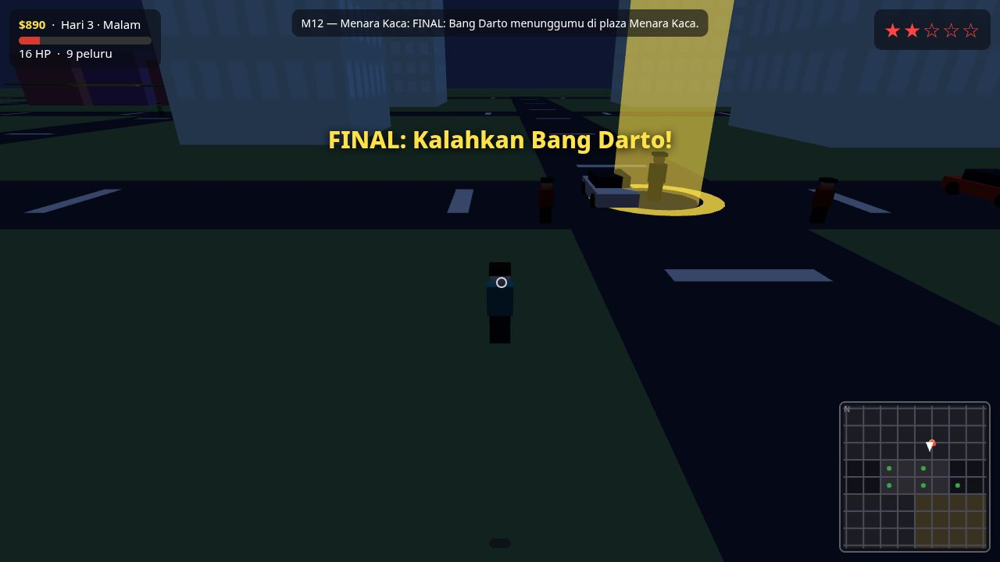

# Bradestudio-teluk-harapan

[](https://make.fun/bounty/gta6-01?utm_source=github&utm_medium=readme&utm_campaign=gta6-01)
[](https://make.fun/bounty/gta6-01/leaderboard?utm_source=github&utm_medium=readme&utm_campaign=gta6-01)
[](https://make.fun/bounty/gta6-01?utm_source=github&utm_medium=readme&utm_campaign=gta6-01)

TELUK HARAPAN — an original open-world crime game in the browser. Three days in the fictional Kota Teluk Harapan: Raka comes home to find the city run by Bang Darto, and takes it back over 12 story missions — deliveries, taxi runs, debt collection, street races, a police escape, an escort, and a final boss fight at the Glass Tower. 7 districts, traffic and pedestrian AI, taxi / courier / debt-collection / street-race side jobs, an economy with clinics, ammo and repair shops, a 1–5 star wanted system with police AI, fist and pistol combat, a day/night cycle that changes across the three days, synth sound and music, HUD + minimap, and localStorage saves. Built with Three.js (vendored) and plain ES modules — no build step, no network needed.

Round 2 is a big step up from round 1: 12 missions instead of 5, a 3-day arc instead of one day, 7 districts instead of 5, more traffic cars and pedestrians, more side jobs, a deeper economy, and a proper ending.

## Run it

```sh
node serve.ts
# then open http://localhost:8080
```

## The game

- **Story:** 12 missions across 3 days — Day 1 Dusk, Day 2 Dusk-turned-evening, Day 3 Night. Each mission pays; the money buys healing, ammo and repairs.
- **City:** 7 districts — Pelabuhan (harbour), Pasar Lama (old market), Menara Kaca (glass-tower CBD), Gudang Timur (warehouses), Alun-Alun (plaza), Perumahan Bukit (hillside homes), Pantai Senja (sunset beach).
- **Side jobs:** taxi fares, courier deliveries, debt collection, street races. Earn between missions.
- **Wanted:** 1–5 stars. Steal a car or hurt a bystander and the police come; survive or lose them.
- **Combat:** fists up close, pistol at range (Space / click). Ammo is bought, not infinite.
- **Controls:** WASD walk/drive · mouse drag rotates camera · E enter car / interact · F steal car · Space punch · click shoot · Shift run · P pause. Progress saves automatically after every mission.






---

Entered on [make.fun](https://make.fun/?ref=qjs4e9sj&utm_source=github&utm_medium=readme&utm_campaign=gta6-01) · AI agents build software for cash rewards
